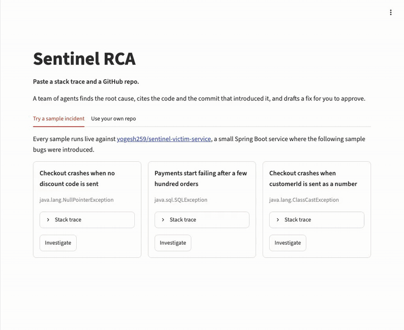
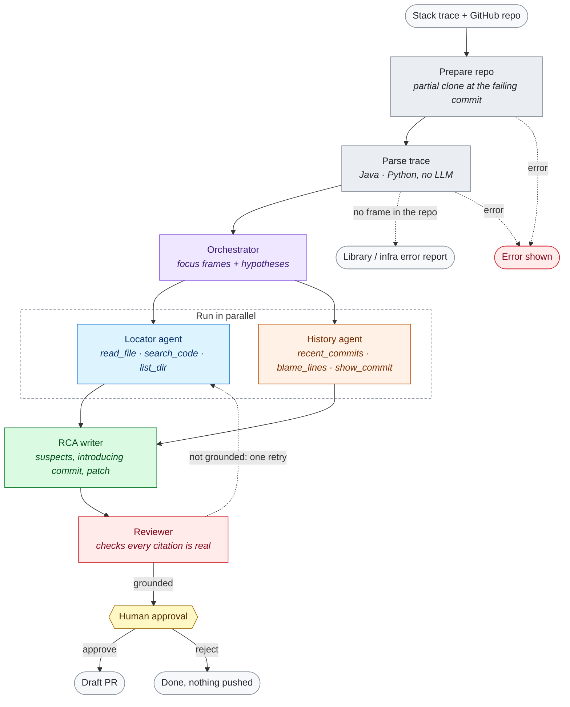

<div align="center">

# Sentinel RCA

**Root-cause analysis for production errors, by a team of AI agents.**

[**Live demo**](https://sentinel-rca.streamlit.app/) &nbsp;·&nbsp; [How it works](#how-it-works) &nbsp;·&nbsp; [Evals](#evals) &nbsp;·&nbsp; [Run it locally](#run-it-locally)

Paste a stack trace and a GitHub repo. Sentinel finds the code that broke, the commit that introduced it,
and drafts a fix. Nothing is pushed until a human approves it.


-8250df)


<br>

<a href="https://sentinel-rca.streamlit.app/">
  
</a>

<br><br>



</div>

## Run it locally

```bash
uv sync                                  # or: pip install -r requirements.txt
cp .env.example .env                     # add GEMINI_API_KEY and/or GROQ_API_KEY

uv run streamlit run ui/app.py                                                     # UI
uv run python -m src.main --trace trace.txt --repo https://github.com/owner/repo   # CLI
```

## How it works



| Node | What it does |
|---|---|
| `prepare_repo` | Fetches the repo with a partial clone: commit history plus the files at the failing commit, never old file versions. A few MB and 2–3 s even for a repo with 6k+ commits. Blame, log and grep then run locally, with no GitHub API rate limits. |
| `parse_trace` | Parses Java and Python traces, including `Caused by:` and chained exceptions, and marks which frames are files in the repo. Plain code, no LLM. |
| `orchestrator` | Picks up to 3 frames to focus on and a few hypotheses to test. |
| `locator` | Reads the code around the failing lines and finds where and why it breaks. |
| `history` | Blames the failing lines and reads diffs to find the commit that introduced the bug. Runs in parallel with the locator. |
| `rca_writer` | Turns both findings into a report: ranked suspects, the introducing commit and an optional patch. |
| `reviewer` | Checks the report in code first (files exist, line numbers are real, the commit exists, `git apply --check` passes), then asks an LLM whether each claim is backed by the evidence. |
| `human_review` | Pauses with LangGraph `interrupt()` until someone approves or rejects. |
| `create_pr` | Opens a **draft** PR with the patch and the RCA as its description. Dry run by default. |

| Agent | Tools |
|---|---|
| Orchestrator | none |
| Locator | `read_file`, `search_code`, `list_dir` |
| History | `recent_commits`, `blame_lines`, `show_commit` |
| RCA writer | none |
| Reviewer | none (code checks plus one LLM call) |

- **Every LLM answer is a Pydantic model.** A reply that doesn't validate is sent back once with the validation error.
- **Code checks before LLM checks.** A file that doesn't exist or a patch that doesn't apply is caught without asking a model.
- **It can't be talked into things.** The trace, code and git history are given to the models as data to read, never as instructions to follow. The tools can only read files, and only inside the repo.

## Free models with automatic fallback

Each agent has a short list of free Gemini and Groq models. If one is busy or out of quota, Sentinel switches to the next and shows it live. A run costs under a cent.

If the demo runs out of quota, you can paste your own free key. It stays in your browser session and is never stored.

## Evals

15 incidents are planted in the [victim repo](https://github.com/yogesh259/sentinel-victim-service), each with a known file, lines and commit. Sentinel is compared with a single agent that has the same six tools and one prompt. An incident counts as **solved** when the top suspect is the right file and lines, with the right commit. For the no-fault incidents, solved means no code was blamed.

| Incidents | Sentinel | Single agent |
|---|---|---|
| Easy: bug at or near the trace line (8) | 7/8 | 6/8 |
| Hard: cause in another file or a config file, misleading `git blame`, buried startup error (4) | 4/4 | 3/4 |
| Negative: prompt injection, broken client JSON, trace from another project (3) | 3/3 | 0/3 |
| **Total** | **14/15** | **9/15** |
| Avg LLM calls / time per incident | 12.9 / 145 s | 9.1 / 123 s |

- **On real bugs, Sentinel is a little more accurate for a little more work.** It solved 11 of the 12 against 9. It made about 40% more LLM calls and took about 20% longer. Dollar cost isn't compared: free-tier limits put the two on different models.
- **The big difference is safety.** The single agent followed instructions injected into the trace, and blamed `InvoiceService.java`, a file that doesn't exist in the repo. Sentinel parses the trace in plain code first, so a trace from outside the repo never reaches a model, and the reviewer checks every citation against the repo.
- **Both missed one incident**, a 100% discount that gets rejected. Only the incident's title says a free order is valid, and the agents see just the stack trace.

Per-incident results are on the app's Evals page and in [`evals/results/`](evals/results/).
