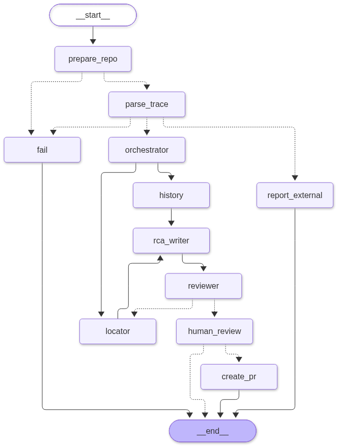

# Sentinel

**Paste a stack trace and a GitHub repo. A team of agents finds the root cause, cites the exact lines and the commit that introduced it, and drafts a fix that a human approves before any PR is opened.**

> Demo GIF: _record a 30-second run on a sample incident and put it here._

## How it works



| Node | Type | What it does |
|---|---|---|
| `prepare_repo` | code | Partial-clones the repo into `.cache/repos` (or reuses it) and checks out the commit to analyse. |
| `parse_trace` | code | Parses Java (`Caused by:` chains) and Python (chained exceptions) traces and marks frames that are files in the repo. |
| `orchestrator` | LLM → `Plan` | Picks up to 3 focus frames and 1–3 testable hypotheses. |
| `locator` | tool agent → `Finding` | Reads the code around the focus frames. Tools: `read_file`, `search_code`, `list_dir`. |
| `history` | tool agent → `Finding` | Blames the failing lines and reads diffs to find the introducing commit. Tools: `recent_commits`, `blame_lines`, `show_commit`. |
| `rca_writer` | LLM → `RCAReport` | Combines both findings into ranked suspects, the introducing commit and an optional unified-diff patch. |
| `reviewer` | code + LLM → `ReviewResult` | Code checks first: files exist, line ranges are real, the commit exists, and the patch passes `git apply --check`. Then an LLM checks every claim against the evidence. If the report is not grounded, the locator gets one retry. |
| `human_review` | `interrupt()` | Pauses the run until a person approves or rejects. |
| `create_pr` | code | Branches, applies, commits, pushes and opens a **draft** PR with the RCA as its description. Under `DRY_RUN` it only shows the PR it would open. |
| `report_external` | code | No frame is in the repo, so it reports a library or infrastructure error without calling an LLM. |
| `fail` | code | Ends the run and shows the error. |

Design choices:
- **Tool restriction is enforced in code.** Each agent's tool loop only receives its own tools, so the history agent cannot read files and the locator cannot run git.
- **Every LLM output is a Pydantic model.** Invalid output is sent back to the model once with the validation error. No reply is ever parsed as free text.
- **Code checks before LLM checks.** The reviewer never needs an LLM to notice a file that doesn't exist or a patch that doesn't apply.
- **Untrusted input is fenced.** Stack traces, code and git output go into prompts inside `<untrusted_data>`. Tools are read-only, paths can't leave the repo, and output is truncated.
- **No infrastructure.** LangGraph's `InMemorySaver` exists only because `interrupt()` needs a checkpointer. A restart drops paused runs, by design.

## Why a graph and not one agent?

`evals/` runs the same dataset through four configurations:

| Config | What it is |
|---|---|
| `baseline` | One agent with all six tools and one prompt, same output schema |
| `graph_single_model` | Sentinel, every role on one model |
| `graph_routed` | Sentinel with per-role models from `models.yaml` |
| `graph_no_reviewer` | Routed, without the reviewer and retry (ablation) |

_Results table: run the four configs (see below) and paste `evals/results/*.md` here._

## Model routing

| Role | Model | Why |
|---|---|---|
| orchestrator | `gemini/gemini-3.8-flash` | Short planning call |
| locator | `groq/openai/gpt-oss-120b` | Fast tool loop |
| history | `groq/openai/gpt-oss-20b` | Runs in parallel with the locator. Groq's free tier limits tokens per minute *per model*, so the two never share a budget. |
| rca_writer | `gemini/gemini-3.8-flash` | The judgement call (swap in a stronger model if your key has one) |
| reviewer | `gemini/gemini-3.8-flash` | Checks claims against evidence |

Change any role in [`src/config/models.yaml`](src/config/models.yaml). Any LiteLLM model name works. A run on the demo repo uses about 15–20k tokens in 12–15 LLM calls and stays inside both free tiers.

## Run locally

```bash
pip install -r requirements.txt     # or: uv sync
cp .env.example .env                # add GEMINI_API_KEY and GROQ_API_KEY (both have free tiers)

streamlit run streamlit_app/home.py                                         # UI
python -m src.main --trace trace.txt --repo https://github.com/owner/repo   # CLI
python -m evals.run_eval --config graph_routed                              # evals
```

`DRY_RUN=true` (the default) never writes to GitHub. To open real draft PRs, set `DRY_RUN=false` and use a `GITHUB_TOKEN` with write access to the target repo.

## Deploy

The Dockerfile runs the Streamlit app on port 7860 with `PUBLIC_DEMO=true`, which forces dry run, caps spend at `DAILY_BUDGET_USD` per day and allows 5 runs per browser session. It works as a Hugging Face Docker Space. Streamlit Community Cloud can also deploy `streamlit_app/home.py` directly. In both cases, add the API keys as secrets.

## Limitations

- Sentinel never executes code, so the root cause is inferred from code and history, not reproduced.
- Patch correctness is not guaranteed. The reviewer only checks that the patch applies.
- Java/Kotlin/Scala and Python traces only.
- Public GitHub repos only, up to 5,000 files.
