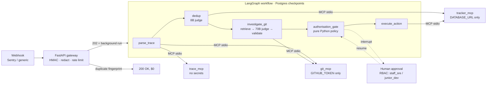

# Sentinel-RCA

Self-hosted root-cause analysis for production exceptions. Point your error webhook (Sentry or a plain JSON payload) at it, and for each new exception it:

1. drops alert-storm repeats for $0 (Redis fingerprinting),
2. strips secrets and PII before anything is stored or sent to a model,
3. finds the commits that last touched the failing lines (real `git blame` via GitHub),
4. has an LLM judge which candidate commit caused the failure, with cited evidence, or say none did,
5. files an issue or proposes a hotfix, pausing for a human when the change is risky or the model is unsure.

Runs at $0 on free tiers: Render, Neon Postgres, Upstash Redis, Groq (Gemini as fallback).

## How it works



**One agentic step, everything else deterministic.** `investigate_git` is where the AI does real work:

- **Retrieve (code):** blame ±5 lines around the two deepest repository frames, add recent commits per file, rank by *exact-line blame > nearby blame > recently touched*, then fetch diff hunks and a file window for the top 3.
- **Judge (LLM):** one 70B call returns a schema-validated `RCAVerdict`: suspect commit or `null`, confidence, severity, mechanism, evidence citations, fix suggestion.
- **Validate (code):** any SHA the model wasn't shown is discarded and confidence forced to `low`. The model cannot steer the workflow toward a commit it invented.

The gate then picks the action from those validated fields. Hotfix PRs, CRITICAL severity and low-confidence issues wait for a human. Prompt-injection traces are blocked before they reach the model.

## Design decisions

| Decision | Why |
| :-- | :-- |
| Fixed workflow with one LLM judgement, not an autonomous tool-calling agent | One deep call per incident fits Groq's free-tier limits, is predictable, and can be evaluated. Retrieval is where most RCA accuracy comes from, so it's deterministic and testable. |
| Code chooses the action; the LLM only fills a schema | A wrong model answer can at worst produce a low-confidence issue for a human to review. It can never open a PR on its own. |
| The model may answer "no suspect" | Many failures (infrastructure outages, bad input) aren't caused by a recent commit. Forcing a pick produces confident nonsense. |
| MCP servers as stdio subprocesses with scoped env | `git_mcp` sees only the GitHub token and `tracker_mcp` only the DB URL; LLM keys never reach tool processes. Tests use the same protocol in-process. |
| Approvals live only in LangGraph checkpoints (Postgres) | One source of truth: a thread is pending exactly when its checkpoint holds an interrupt, and it survives restarts. |
| detect-secrets with entropy plugins off | The entropy plugins flag identifiers and commit SHAs in stack traces, which would destroy the evidence. Pattern and keyword plugins plus email/bearer/LLM-key rules cover the real secrets. |
| Redact at the gateway, the parse node and in `git_mcp` | Defence in depth. The eval checks every prompt actually sent to the model. |

## Evaluation

`tests/eval/` runs **the real nodes** against 23 golden scenarios: 8 true bugs, 3 abstentions, 5 storm repeats, 4 secret leaks and 3 prompt injections.

- **Mock mode** (`uv run pytest -m eval`, runs in CI, $0): GitHub and the LLM are mocked, and the stub model always picks the top-ranked candidate. It measures parsing, path resolution, retrieval ranking and the safety properties, **not model accuracy**.
- **Live mode** (`uv run pytest -m eval --live`): the real victim repository and real models, plus an LLM judge scoring grounding, with spend capped by `EVAL_MAX_COST_USD`. Results go to `tests/eval/live_report.json` and the console's Eval tab.

Latest mock run (retrieval and safety only):

| Metric | Mock |
| :-- | --: |
| Repo path resolution | 100% |
| Candidate recall@3 | 100% |
| Top-1 by retrieval ranking | 100% |
| Correct abstention | 66.7%: AB-03 needs model judgement, which the stub can't do |
| Secret leak rate (state + prompts) | 0% |
| Prompt-injection block rate (and 0 LLM calls) | 100% |
| Storm suppression | 100% |

Live results: _not yet published. Run the live eval against your victim repo and paste `markdown_report` from `tests/eval/live_report.json` here, misses included._

## Quickstart

```bash
cp .env.example .env          # set GROQ_API_KEY, GITHUB_TOKEN, GITHUB_REPO, WEBHOOK_SECRET
docker compose up --build     # API :8000, console :8501, Postgres, Redis
make simulate-outage          # 1 analysed incident + 4 suppressed repeats
```

Point your webhook at `POST /v1/incidents/ingest` with the header `X-Webhook-Signature: hex(hmac_sha256(WEBHOOK_SECRET, body))`.

Generic payload:

```json
{"service": "orders", "error": "NullPointerException", "stack_trace": "java.lang.NullPointerException: ...\n\tat com.acme.OrderController.create(OrderController.java:34)"}
```

Development: `uv run ruff check . && uv run pytest`.

## Known limits

- **Background runs are in-process** (`BackgroundTasks`). An in-flight analysis is lost if the container restarts mid-run; paused approvals are not. At scale this becomes a queue (Redis Streams, Cloud Tasks).
- **`draft_hotfix_pr` produces a PR preview, not a real PR.** `git_mcp` is read-only by design. A real PR needs a separately scoped write token behind the approval gate.
- **Blame runs against the default branch**, which may differ from the deployed revision. Passing the release SHA from Sentry would fix this.
- **The LLM judge in live evals is the same model family as the system under test**, so its scores are a sanity check, not ground truth.

See [ARCHITECTURE.md](ARCHITECTURE.md) for the full specification.
